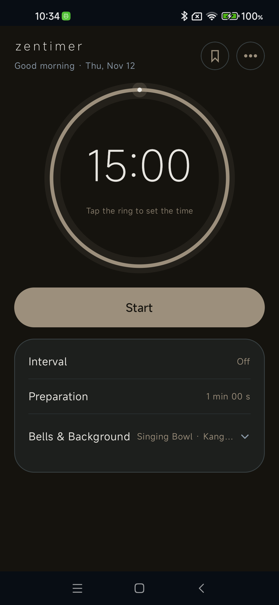
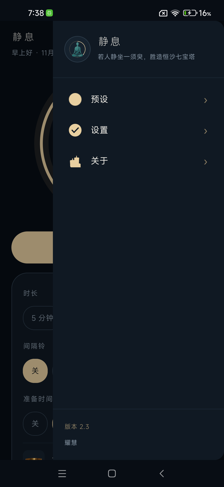
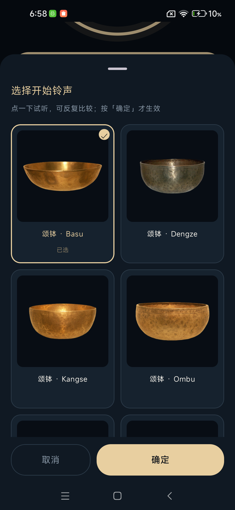
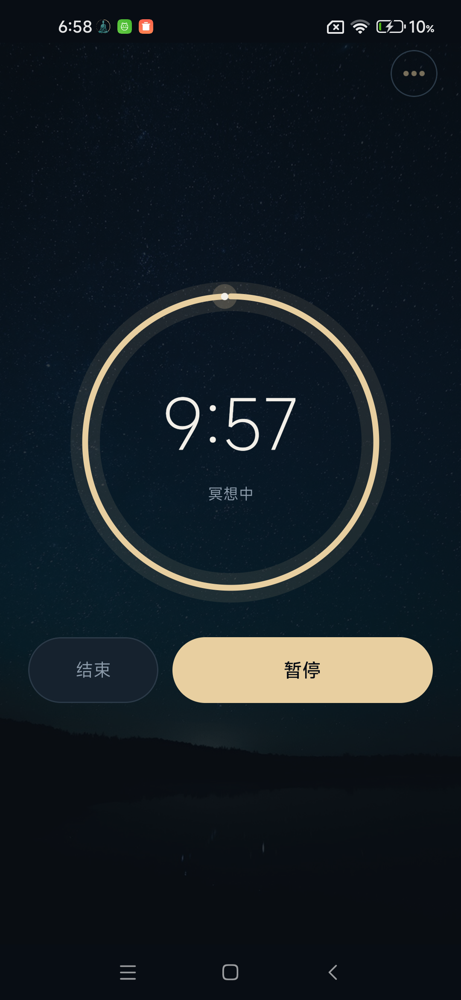
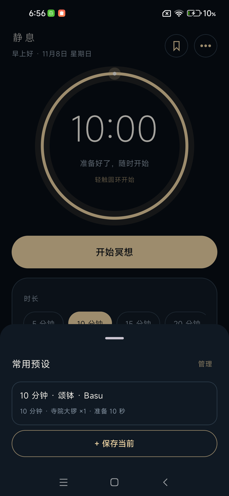
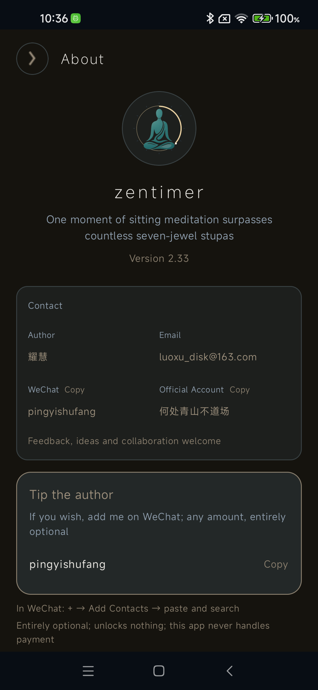
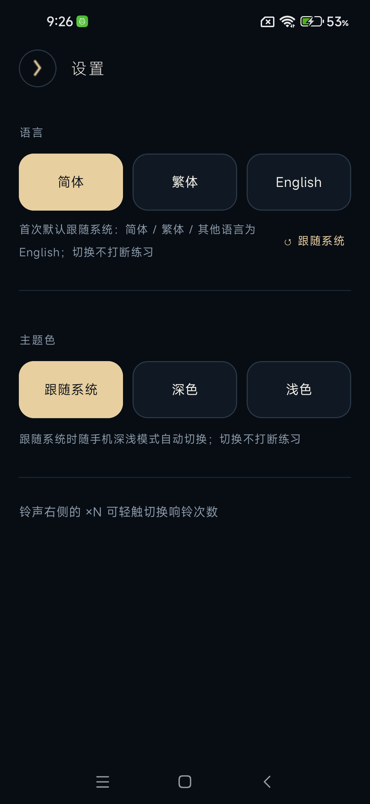
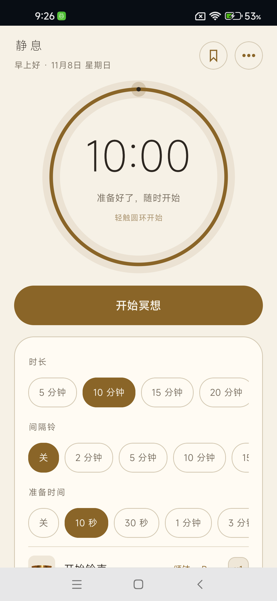
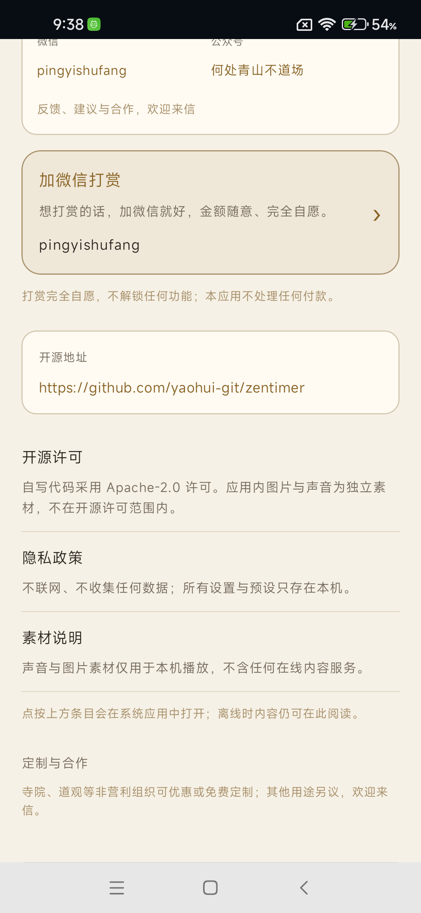

# 静息 · zentimer

> 一款极简禅意静坐计时器（Minimal Zen Sitting Timer）· 仓库 `zentimer` · Android · Apache-2.0
>
> **应用名称**：简体「静息」／繁体「靜息」／English `zentimer`；英文系统的桌面图标与 App 内标题都显示 `zentimer`。「极简禅意静坐计时器 / Minimal Zen Sitting Timer」只是定位描述，**不是应用名**。

> **若人静坐一须臾，胜造恒沙七宝塔**
>
> A moment of still sitting surpasses seven-jewelled pagodas beyond count.

[](LICENSE)
[](https://developer.android.com/)
[](PRIVACY-POLICY.md)

一个**完全离线、极简禅意**的静坐计时工具：一屏一只圆环，选时长、准备安顿、听一声钵、坐一会儿、再听一声钵结束。
没有课程、社区、账号、统计、练习记录、广告、推送与信息流；预设收在顶栏书签，设置与关于收在侧滑抽屉，主屏不留常驻控件。留白、暖金细线、不打扰。

**应用不弹运行时权限对话框**：代码里没有 `requestPermissions` 调用，不会向用户弹网络、位置、通讯录、相机、麦克风、存储、账号或登录授权框。清单共 7 项权限，除勿扰权限外全部安装即授予。**唯一需要用户亲手授权一次的是「静坐时免打扰」**：它是系统「特殊访问权限」，开关默认关闭，只有用户主动打开时才跳到系统设置页；不授权不影响计时、铃声与其余全部功能，撤销授权也不会打断正在进行的一轮。也没有 `INTERNET` 权限，技术上无法联网。无第三方 SDK、无统计、无崩溃上报，所有设置只存本机。

界面、声音与交互围绕「一屏一只圆环」这条主线独立设计；功能边界先做静态梳理，再按「只留计时核心」裁剪。简体中文 / 繁體中文 / English 三语，**首次默认跟随系统**（其他语言自动 English），应用内随时切换，不打断正在进行的练习。

**English summary:** A minimal, offline Zen sitting timer for Android — one ring on screen, one bowl to begin, one bowl to end. No courses, no account, no analytics, no ads, no feeds. **No runtime permission dialogs**: the app never calls `requestPermissions` and never asks for network, location, contacts, camera, microphone, storage or sign-in, and has no `INTERNET` permission at all. The one exception is the optional, off-by-default "Do not disturb while sitting" feature, which needs a one-time grant of notification policy access in system settings; declining it changes nothing else. Simplified Chinese, Traditional Chinese and English, following the system locale by default (English for every other locale); dark / light / system theme. Apache-2.0 covers the code only — bundled third-party audio/images are **not** covered (see [NOTICE](NOTICE.md)).

---

## 截图

| 主页 | 侧滑菜单 | 铃声试听 |
| --- | --- | --- |
|  |  |  |

| 计时中 | 预设面板 | 关于 / 打赏 |
| --- | --- | --- |
|  |  |  |

> 预设只占顶栏一个书签图标，点开才是上面第二张的面板——主屏留给时间设置。

| 设置（语言 / 主题色） | 浅色主题 | 定制与合作 |
| --- | --- | --- |
|  |  |  |

> 主题色在设置页切换：跟随系统 / 深色 / 浅色。浅色是宣纸米白 + 赭金，仍保持同样的克制层次；「四时」只在同一张纸上做极轻微的冷暖微调，不做四套配色。

启动图标（方案 B「圆环计时」）：[`assets/icon-512.png`](assets/icon-512.png)。完整三方案对比见 [`store/图标方案对比.png`](store/图标方案对比.png)。

---

## 功能

| | |
| --- | --- |
| 计时 | 静坐 `15 / 30 / 45 / 60 分` 一点即选，或「自定义」展开滚轮设到 **23 时 59 分**；圆环进度 + 端点光点。**静止时轻触圆环改时长，开始静坐用下方大按钮**；倒计时满一小时显示 `H:MM:SS` |
| 准备 | `1 / 3 / 5 / 10 分` 四档或自定义（0 秒 ~ 10 分 59 秒）；准备阶段只放背景音，**开始铃在准备结束、正式计时开始时才响**；准备阶段也可暂停 |
| 铃声 | 9 种颂钵实物录音 + 寺院大锣 + 木鱼 + 静音轨；开始 / 间隔 / 结束分别设定，**点一下试听、可反复比较，按「确定」才生效** |
| **响铃次数** | 每个铃声右侧 `×N`，轻触在 **1 / 2 / 3 次**间循环；上一声完全响完后静置 1.8 秒再起下一声 |
| **预设组合** | 把「时长 + 准备 + 间隔 + 三种铃 + 背景音 + 响铃次数」整套存成一个方案，最多 6 个；**顶栏书签 → 底部面板，一点即应用**；保存 / 管理收在面板内，最近应用的一套高亮「已选」，可命名、可删除（删除有二次确认） |
| 背景音 | 13 种环境音，开始自动循环、暂停 / 结束自动停止 |
| 锁屏 | 前台服务驱动计时锚点，锁屏 / 切后台 / 进程被回收后仍准点响铃，通知栏显示剩余时间 |
| 语言 | 设置页切换简体 / 繁体 / English，StateFlow 重组不重建 Activity、不打断计时；**首次默认跟随系统：简体 / 繁体 / 其他语言一律 English**，设置页可随时恢复「跟随系统」 |
| **主题色** | **跟随系统 / 深色 / 浅色**三档，设置页即时切换、不打断练习。深色是冷墨蓝 + 暖米金，浅色是宣纸米白 + 赭金，保持同一套层次、不加花哨配色 |
| **四时纸色** | 一年按公历四次微调「纸」的冷暖与明暗，文字颜色全年不变；只在打开应用时取一次，**静坐进行中绝不换色**，不提示、不解释、不庆祝。设置里「随节气微调」可关，关掉固定秋档；没有春 / 夏 / 秋 / 冬四选一 |
| **静坐时免打扰** | 设置里一个开关，**默认关闭**，需系统在「勿扰权限」页授权一次。打开后开始静坐会启用一条名为「静坐」的系统模式，结束时自动停用；只管自己这条模式，**不改动系统全局勿扰状态**，用户原本的规则与勿扰状态都不被改写。闹钟、媒体声与收藏联系人来电保留。应用被强杀、手机重启、结束后没再打开，都有兜底把这条模式停掉 |
| 交互 | 菜单是**侧滑抽屉**（边缘手势 / 点遮罩 / 返回收起）；系统返回键逐层回退，主页再按一次才退出；时长设置位于卡片顶部、铃声在下 |
| 首屏克制 | 预设**不占主屏常驻空间**——只有顶栏一个书签图标，点开才出现底部面板。选预设是高频、保存 / 管理是低频，两者不放同一层级；时间设置区始终留在首屏 |
| 关于 | 版本、作者、邮箱、微信、公众号、**开源地址**、许可、隐私政策、素材说明（离线可读） |
| **打赏** | 「加微信打赏」：点一下复制微信号并唤起微信。**不内嵌支付、不展示收款码**，本应用不处理任何付款 |
| 全面屏 / 尺寸 | 用系统 `WindowInsets.safeDrawing`（statusBars + displayCutout + navigationBars）避开挖孔 / 刘海 / 曲面；内容列按最大宽度居中收敛、圆环随屏宽与横竖屏自适应、抽屉与铃声网格自适应。**不按机型硬编码**；折叠屏铰链感知 / 双栏布局复杂度高，当前不做（本项未做真机专项测试） |
| 不弹运行时授权框 | 代码中没有任何 `requestPermissions` 调用：不弹网络 / 位置 / 通讯录 / 相机 / 麦克风 / 存储 / 账号登录授权框。唯一的例外是「静坐时免打扰」需要用户在系统设置里亲手授权一次勿扰权限，**默认关闭、可完全不用** |

**权限 / 不弹运行时授权框**：清单声明 7 项 —— `FOREGROUND_SERVICE`、`FOREGROUND_SERVICE_SPECIAL_USE`、`POST_NOTIFICATIONS`、`WAKE_LOCK`、`POST_PROMOTED_NOTIFICATIONS`（以上 5 项为前台保活、息屏唤醒与锁屏计时展示，安装即授予）、`ACCESS_NOTIFICATION_POLICY`、`RECEIVE_BOOT_COMPLETED`（以上 2 项为 v2.25「静坐时免打扰」与重启后收干净残留规则）。打包时 Android 会自动追加 1 条 `DYNAMIC_RECEIVER_NOT_EXPORTED_PERMISSION`，不是我们申请的。**应用从不调用 `requestPermissions`，不会向用户弹出任何运行时授权框**；只有用户主动打开「静坐时免打扰」时才跳一次系统的「勿扰权限」设置页，这与弹框授权是两回事，不授权不影响计时与铃声。**无 INTERNET**，无位置 / 通讯录 / 相机 / 录音 / 健康数据 / 广告 ID / 内购。manifest 里的 `<queries>` 是 Android 11+ 包可见性声明，不是权限。

---

## 安装

> **当前稳定版：v2.17（versionCode 18，2026-11-09）**。本版先在仓库里放约一周观察，收集 Issue 反馈、按需修补，之后才考虑更广泛地推广；商店上架等推广动作**本轮不做**。四个显示表面的验收结论见下方「真机验收」与 [`CHANGELOG.md`](CHANGELOG.md)。遇到问题请走 GitHub Issues。

直接装 [`releases/zentimer-v2.17.apk`](releases/zentimer-v2.17.apk)（Android 8.0 / API 26+，约 27 MB，已签名并对齐）。

```bash
adb install -r releases/zentimer-v2.17.apk
```

签名证书 SHA-256：`64047d9373cf2e7b942bf171e180c5b65c5e2601c68e9260c2b4aef55cc480d9`（`zentimer.jks`，主体 `CN=zentimer`，RSA 2048 / 有效期约 27 年）。

**包名 `com.yaohui.zentimer`，内测期变更过包名与签名密钥**，因此早于本次命名的安装包**不能直接覆盖升级**，请先卸载再装；旧的设置与预设不会迁移。自本版起，同一包名 + 同一证书的后续版本可以正常覆盖升级。

> MIUI / HyperOS 需要在「开发者选项」里同时打开 **USB 调试** 与 **USB 安装（安全设置）**，安装时手机会弹确认框；按钮一开始是灰色的，等倒计时结束或勾选风险提示后才会变亮。

---

## 构建

本机已验证环境：JDK 17、Android SDK 37 + build-tools 36、Gradle 9.6.0、AGP 9.4.0、Kotlin 2.2.10、Compose BOM 2026.06.01。

```bash
export JAVA_HOME=/path/to/jdk-17
export ANDROID_HOME=/path/to/android-sdk
cd ZenTimer

# 首次：从 example 复制并填自己的密钥（keystore.properties 与 .jks 均不入库）
cp keystore.properties.example keystore.properties

gradle assembleDebug
gradle assembleRelease
```

`local.properties` 里的 `sdk.dir` 换成自己的 SDK 路径即可。仓库用官方 `dl.google.com/dl/android/maven2` + 阿里云镜像，绕开某些网络环境下 `maven.google.com` 走代理 502 的问题。

提交改动前跑一遍文案对账：

```bash
python tools/check_lang.py   # 三语 key 对账，缺一条就 exit 1
```

---

## 真机验收

SDK 的 `platform-tools/adb.exe` 可直接用：

```bash
adb devices -l
adb shell am start -n com.yaohui.zentimer/.MainActivity
adb shell uiautomator dump /sdcard/ui.xml && adb pull /sdcard/ui.xml
adb shell screencap -p /sdcard/s.png && adb pull /sdcard/s.png
adb logcat -d | grep -i zentimer
```

v2.3 已在 **M2003J15SC（Redmi Note 9 系列，Android 12 / SDK 31，1080×2340 @440dpi）** 上实装验证：启动、控件树、抽屉、返回栈、截图与崩溃日志。**注意**：Android 15+ 才强制 edge-to-edge，低版本设备测不出顶部 insets 的最终效果，目标机红米 15 Pro 上的表现仍需目视确认；不同屏幕尺寸 / 折叠屏的适配按项目所有者要求**未做真机专项测试**。
> **（2026-11-09 更新，以本段为准）**：上一段是 v2.3 时期记录，其中「红米 15 Pro 仍需目视确认」已在 v2.17 完成；原文保留作过程记录。

**v2.17 稳定版验收**：在 Redmi Note 15 Pro（HyperOS / Android 16）上完成四个显示表面的真机像素验收 —— 顶栏胶囊显示实时倒计时；通知栏下拉与亮屏锁屏只保留一组走秒数字、中间一行统一「静坐中」；充电锁屏 AOD 只显示时钟图标 +「静坐中」，不给数字。字段层 13 项 + AOD 专项 14 项真机断言零失败；离线逻辑用例 24 项、静态审查 21 项、三语文案 110/110/110 零差异。逐项结论见 [`CHANGELOG.md`](CHANGELOG.md) 的 v2.16 / v2.17 两节。
**边界如实写**：以上只覆盖这一台设备；非小米 Android 16、Android 8~15 机型的通知观感仍缺真机验证，欢迎通过 GitHub Issues 反馈。

---

## 打赏作者

这个应用是个人作品，完全免费、无广告、无内购，打赏纯属自愿，**不解锁任何功能**。

如果它对你有用，想支持一下：

> **加微信 `pingyishufang`（平人）**，金额随意、完全自愿。

应用「关于」页里点一下「打赏作者」会自动复制微信号并唤起微信；你也可以在微信里直接搜索这个号。**本应用不展示收款码、不内嵌支付、不接任何支付 SDK、不处理金额 / 订单 / 付款结果**，付款全程发生在微信里。

之所以刻意不做内嵌支付：微信个人收款码没有公开的一步唤起接口，支付宝个人静态收款码用于经营性 / 远程非面对面收款存在明确合规红线（央行银发〔2021〕259 号），国内商店的「虚拟打赏」还可能要求 ICP 经营许可证。

| | |
| --- | --- |
| 作者 | 耀慧 |
| 邮箱 | <luoxu_disk@163.com> |
| 微信 | `pingyishufang` |
| 公众号 | 何处青山不道场 |
| 开源地址 | <https://github.com/yaohui-git/zentimer> |

## 定制与合作

**支持定制。** 寺院、道观等非营利组织可享**优惠或免费**定制；其他用途另议。

可定制范围：应用名称、启动图标、主题配色、铃声与背景音、默认时长 / 准备 / 间隔方案、界面文案与「关于」页信息。定制版同样守住三条底线：**离线、不弹运行时授权框、无广告**，并保持极简禅意。「静坐时免打扰」按需要决定是否保留，保留时仍需用户在系统设置里亲手授权一次。

联系：耀慧 · <luoxu_disk@163.com> · 微信 `pingyishufang` · 公众号「何处青山不道场」。

**English:** Custom builds are welcome. Temples, Taoist centres, monasteries and other non-profit organisations receive **discounted or free** customisation; all other uses are quoted individually. Name, icon, palette, bells, default durations and wording can be tailored — always offline, permission-prompt-free and ad-free.

---

## 开源协议与素材授权（务必先读）

- **代码**：`LICENSE` 采用 **Apache License 2.0**。适用于 Kotlin 源码、Gradle 脚本、本项目自写的 XML / 文案 / 绘制逻辑、`tools/` 脚本。
- **素材不在协议范围内**：`NOTICE.md` 与 [`ASSETS-NOTICE.md`](ASSETS-NOTICE.md) 逐项列明。`res/raw/` 的 23 段录音与 `res/drawable-nodpi/` 的 36 张界面图属于**第三方资产**，不在 Apache-2.0 范围内；**公开分发 / 商用前请自行确认授权或替换**。启动图标（方案 B）为本项目自绘，其中打坐人形剪影由项目所有者提供。
- **一键净化**：`python tools/asset_privacy.py strip` 把实物素材移到本地 `assets-private/`（不入库），生成同名自绘占位，公开仓库仍能编译；本地 `restore` 即恢复完整版。
- **打包干净仓库**：`python tools/make_oss_repo.py` 生成只含白名单文件的 `oss/`，排除签名密钥、密码、构建产物与逆向证据。

> 个人自用与公开分发是两回事。若你 fork 后要再分发，请先处理素材授权，别默认这些音频 / 图片也在 Apache-2.0 里。

---

## 隐私

不联网、不收集任何数据、不含第三方 SDK、不弹运行时授权框。语言 / 主题色偏好、设置与预设只存在本机 SharedPreferences，卸载即清除。完整政策见 [`PRIVACY-POLICY.md`](PRIVACY-POLICY.md)。

---

## 目录

```
ZenTimer/            Android 工程（Gradle + Kotlin + Compose，单模块）
  app/src/main/java/   状态机、音频、语言、主题色、预设、前台服务、单 Activity UI
  app/src/main/res/    三语 strings、配色、主题、启动图标、声音与图片素材
tools/                 图标生成、素材隐私开关、开源目录打包、三语文案对账
assets/                启动图标 512
screenshots/           真机截图
store/                 商店图标、宣传图、三套图标方案对比
releases/              已签名 APK
LICENSE / NOTICE.md / CONTRIBUTING.md / PRIVACY-POLICY.md
ASSETS-NOTICE.md / CHANGELOG.md / STORE-LISTING.md
```

---

## 参与

见 [`CONTRIBUTING.md`](CONTRIBUTING.md)。问题与建议请走 GitHub Issues。

---

*本项目为个人独立作品。*
